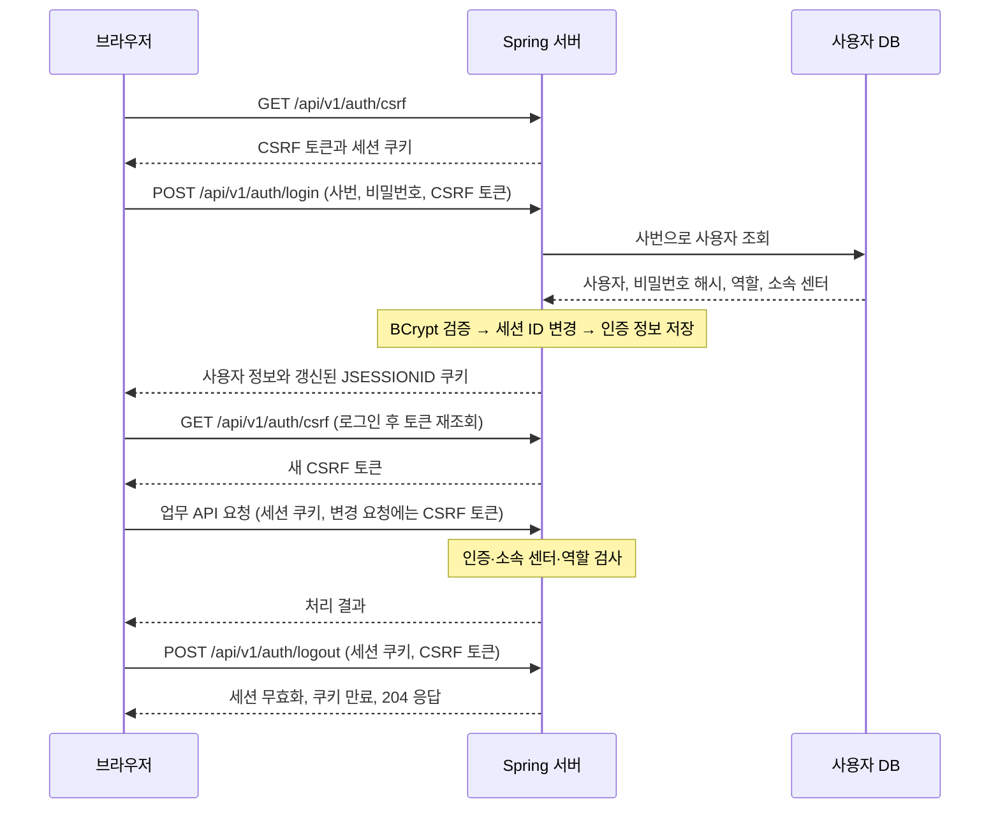

# 차곡 사용자 인증·권한 처리

> 차곡은 Spring Security와 서버 세션을 사용해 직원을 인증하고, 직원의 역할과 소속 물류센터를 기준으로 API 접근 권한을 검사한다.

## 1. 인증 구조

직원은 사번과 비밀번호로 로그인한다. 서버는 DB에 저장된 비밀번호 해시를 검증한 뒤 인증 정보를 서버 세션에 저장한다. 브라우저는 이후 요청에 `JSESSIONID` 쿠키를 보내고, 서버는 해당 세션의 인증 정보를 사용한다.

| 구분 | 구현 방식 |
|---|---|
| 로그인 정보 | 사번(`employeeId`), 비밀번호(`password`) |
| 사용자 저장 | `app_user` 테이블 |
| 비밀번호 검증 | `BCryptPasswordEncoder`로 입력값과 저장된 해시 비교 |
| 로그인 상태 유지 | 서버 세션과 `JSESSIONID` 쿠키 |
| 인증 정보 저장 | `HttpSessionSecurityContextRepository` |
| 권한 판단 | 직원의 역할(`role`)과 소속 센터(`warehouse`) |

## 2. 로그인부터 로그아웃까지

로그인 시에는 다음 순서로 처리한다.

1. 사번에 해당하는 사용자가 한 명인지 확인한다.
2. BCrypt로 비밀번호를 검증하고, 소속 센터가 있는지 확인한다.
3. 역할이 `VIEWER`, `OPERATOR`, `ADMIN` 중 하나인지 확인한다. 역할이 없으면 `VIEWER`로 처리한다.
4. 기존 세션 ID를 변경하고, 사용자 ID와 역할을 담은 인증 정보를 세션에 저장한다.
5. 사용자 정보와 세션 쿠키를 응답한다. 비밀번호 해시는 응답에 포함하지 않는다.

로그인 성공 시 기존 CSRF 토큰을 초기화하므로, 브라우저는 로그인 후 토큰을 다시 조회한다.

## 3. API 접근 권한

인증은 **누가 요청했는지**를 확인하고, 인가는 **그 직원이 해당 작업을 할 수 있는지**를 확인한다.

| 검사 기준 | 적용 내용 | 예시 |
|---|---|---|
| 로그인 여부 | 보호된 API는 인증된 세션이 필요 | 로그인 없이 재고를 조회하면 `401` |
| 역할 | 조회는 로그인한 직원, 업무 변경은 `OPERATOR` 또는 `ADMIN` | `VIEWER`가 재고를 수정하면 `403` |
| 소속 센터 | URL의 `warehouseId`와 직원의 소속 센터 ID 비교 | 서울센터 직원이 부산센터에 접근하면 `403` |

소속 센터 검사는 창고 API의 공통 필터에서 수행하며, `ADMIN`도 자신의 소속 센터로 제한한다. 발주·알림 등의 서비스에서도 현재 사용자를 조회해 소속 센터를 확인한다.

로그인, CSRF 토큰 조회, 상태 확인(`health`) 등은 인증 없이 접근할 수 있다. 로그인 요청에도 CSRF 검증은 적용한다.

알림 읽음 경로는 로그인한 직원이 사용할 수 있도록 보안 규칙이 설정되어 있으나, 개별·전체 읽음 API 자체는 현재 미구현이다.

## 4. 세션과 요청 보호

| 항목 | 현재 구현 |
|---|---|
| 기본 세션 유지 | 마지막 접근 후 30분간 요청이 없으면 만료 |
| 로그인 유지 선택 | `rememberMe=true`이면 세션 비활성 만료 시간을 7일로 설정하고, 쿠키 유지 기간도 7일로 설정 |
| 세션 ID 변경 | 로그인 성공 시 `changeSessionId()` 호출 |
| 쿠키 설정 | `HttpOnly`, `SameSite=Lax`, `Path=/` |
| Secure 쿠키 | `SESSION_COOKIE_SECURE` 설정 또는 HTTPS 요청 여부에 따라 적용 |
| CSRF 검증 | 서버 세션에 저장된 토큰으로 POST·PATCH·PUT·DELETE 등의 변경 요청 검사 |
| CORS | 설정된 프론트엔드 출처에 대해 쿠키를 포함한 API 요청 허용 |
| 로그아웃 | 서버 세션 무효화, 인증 정보 제거, 쿠키 만료 처리 |

CSRF 토큰 조회 API는 토큰과 함께 요청 헤더명(`X-CSRF-TOKEN`)을 반환한다. 프론트엔드는 쿠키와 해당 헤더를 함께 보내 변경 요청을 수행한다.

## 5. 코드 역할과 API

인증은 상품·재고·발주에서 공통으로 사용하므로 `global` 영역에 두고, 직원 데이터는 `domain/user`에서 관리한다.

| 코드 | 담당 역할 |
|---|---|
| [AuthController](../src/main/java/com/skala/chagok/global/auth/AuthController.java) | 로그인·내 정보 조회·로그아웃·CSRF 토큰 조회 |
| [SecurityConfig](../src/main/java/com/skala/chagok/global/config/SecurityConfig.java) | 인증 필터, 역할·소속 센터 검사, BCrypt·CSRF·CORS 설정 |
| [CurrentUserProvider](../src/main/java/com/skala/chagok/global/auth/CurrentUserProvider.java) | 인증 정보의 사용자 ID로 DB에서 현재 직원 조회 |
| [AppUser](../src/main/java/com/skala/chagok/domain/user/entity/AppUser.java) | 사번, 비밀번호 해시, 역할, 소속 센터 저장 |
| [AppUserRepository](../src/main/java/com/skala/chagok/domain/user/repository/AppUserRepository.java) | 사번·사용자 ID로 직원 조회 |

| 메서드 | 경로 | 처리 결과 |
|---|---|---|
| GET | `/api/v1/auth/csrf` | CSRF 토큰과 헤더명 반환 |
| POST | `/api/v1/auth/login` | 로그인 검증 후 세션 생성·갱신, 사용자 정보 반환 |
| GET | `/api/v1/auth/me` | 현재 로그인한 직원 정보 반환 |
| POST | `/api/v1/auth/logout` | 세션 종료 후 `204 No Content` 반환 |

인증 실패는 `401 UNAUTHENTICATED`, 역할·센터 권한 부족이나 CSRF 검증 실패는 `403 FORBIDDEN`으로 응답한다.

기본 설정은 `AUTH_ENABLED=true`다. 명시적인 로컬 테스트용으로 `false`를 설정하면 인증·CSRF 검사를 비활성화하고, 현재 사용자 조회는 사번순 첫 번째 직원을 반환한다.

관련 동작을 검증하는 기존 테스트는 [AuthFlowIntegrationTest](../src/test/java/com/skala/chagok/workflow/AuthFlowIntegrationTest.java)에 있다. 로그인·세션 ID 변경·비밀번호 오류·역할 제한·다른 센터 접근 차단·CSRF·로그아웃·CORS를 다룬다.

## 6. 발표용 설명 예시

> 저희는 Spring Security 기반의 세션 인증을 구현했습니다. 직원이 사번과 비밀번호로 로그인하면 BCrypt로 비밀번호를 검증하고, 인증 정보를 서버 세션에 저장합니다. 이후에는 브라우저가 보내는 세션 쿠키로 로그인 상태를 확인합니다. 업무 API에서는 직원의 역할과 소속 물류센터를 함께 검사해, 조회·수정 권한과 센터별 데이터 접근을 제한합니다. 또한 CSRF 토큰 검증과 로그인 시 세션 ID 변경을 적용하고, 로그아웃 시 서버 세션을 무효화하도록 구현했습니다.
